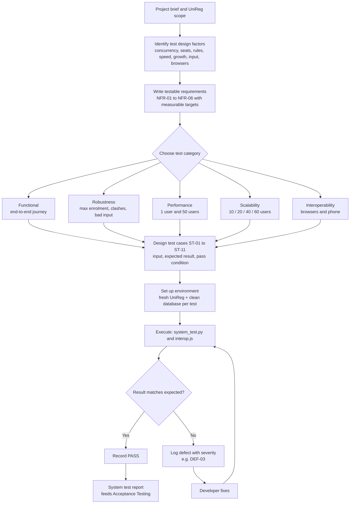

# Test design process model

How we went from the brief to executed system tests. The diagram renders on GitHub. For the report, use [test-design-process.png](test-design-process.png).

## Steps in words

| Step | Input | Output |
|---|---|---|
| 1. Identify factors | Brief, UniReg features, expected users | Factor table ([test-design-factors.md](test-design-factors.md) §1) |
| 2. Write requirements | Factors | NFR-01 to NFR-06 with targets (§2) |
| 3. Pick categories | Requirements; the brief's list | Functional, robustness, performance, scalability, interoperability |
| 4. Design cases | Categories and targets | ST-01 to ST-11 ([system-test-plan.md](system-test-plan.md)) |
| 5. Prepare environment | Prototype, Python, Playwright | Each test starts its own UniReg with a clean database |
| 6. Execute | Scripts | `results/system_results.md`, `results/interop_results.md`, screenshots |
| 7. Evaluate and log defects | Actual vs expected | PASS / FAIL, defects (DEF-03) |
| 8. Re-test after fixes | Fixed build | Updated results; hand over to Acceptance Testing |
