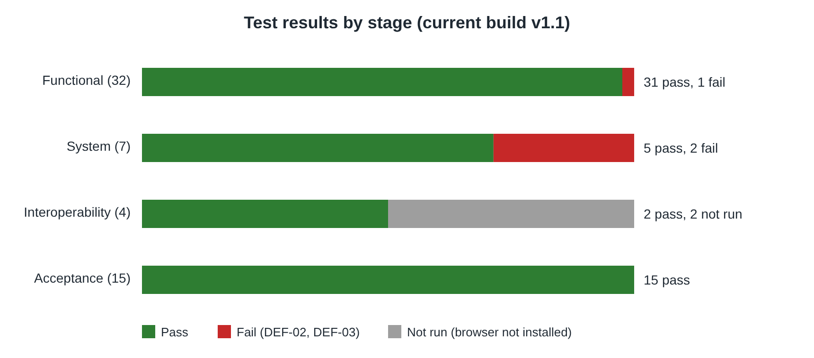
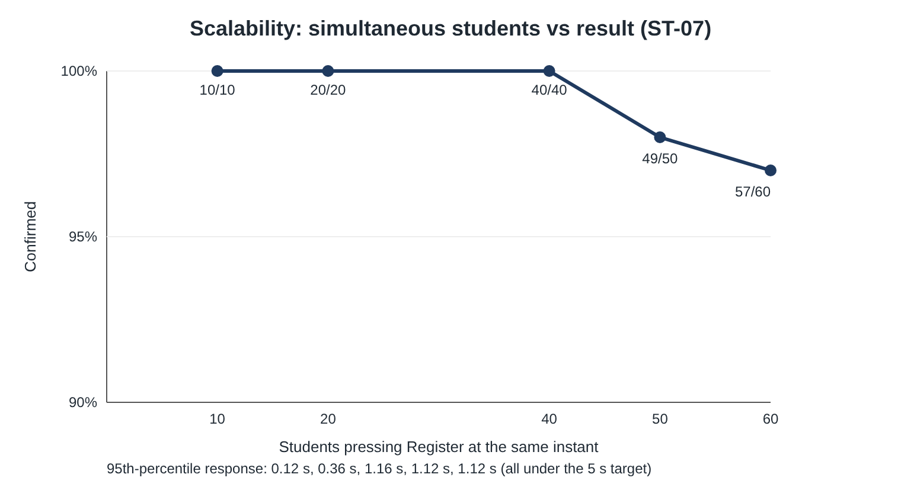

# Consolidated results and analysis (draft)

A draft of the combined results section, written from the actual runs in this repo. Edit the wording, then paste it into the report as section 5. If the group fixes DEF-02 and DEF-03 in a v1.2, update the numbers marked ✱.

## 5.1 Summary of execution

| Stage | Owner | Cases | Passed | Failed | Not run | Build |
|---|---|---|---|---|---|---|
| Functional Testing | Amir | 32 (FT-01 to FT-32) | 31 | 1 ✱ | 0 | v1.1 |
| System Testing | Ramzi | 7 (ST-01 to ST-07) | 5 | 2 ✱ | 0 | v1.1 |
| Interoperability | Ramzi | 4 (ST-08 to ST-11) | 2 | 0 | 2 | v1.1 |
| Acceptance Testing, cycle 1 | Yasierul | 15 (UAT-01 to UAT-15) | 14 | 1 | 0 | v1.0 |
| Acceptance Testing, cycle 2 | Yasierul | 15 | 15 | 0 | 0 | v1.1 |

## 5.2 Defects found

| ID | Found by | Description | Severity | Status |
|---|---|---|---|---|
| DEF-01 | UAT-14 (also ST-02 on v1.0) | When 50 students register for the last 10 seats at the same moment, 15 to 24 are enrolled. Two requests both read "9 taken" before either saves. | Critical | Fixed in v1.1 (database lock around check-and-insert); re-test passed |
| DEF-02 | FT-31 | Logout clears the browser cookie but doesn't end the session on the server, so a copied cookie still opens the student's timetable. | Medium | Open ✱ |
| DEF-03 | ST-06, ST-07 | When 40 or more requests arrive at exactly the same instant, a few connections are sometimes refused because the server only queues 5 waiting connections. | High | Open ✱ |

## 5.3 Analysis

**Each stage found something the others couldn't.** Functional testing checks one student at a time, so it confirmed every business rule (credits, clashes, capacity, duplicates) but couldn't see DEF-01, which only appears when requests overlap. Acceptance testing simulated registration day and caught DEF-01. System testing pushed harder, with requests released at exactly the same instant, and found DEF-03, a limit in the web server rather than in UniReg's own logic. Error guessing found DEF-02, a security gap that no requirement-based test would have looked for. Using several techniques was worth it.

**The core rules are sound.** Across 32 functional cases, a 300-action random run and the concurrent robustness tests, no student ever exceeded 20 credits, held clashing courses, or got a seat in a full course on v1.1. The fix for DEF-01 held in all three runs of ST-02 and in UAT-14.

**Performance is well inside the target.** A single registration takes a few milliseconds. With 50 students at once, the 95th-percentile response was about 1.1 to 1.6 s, well under the brief's 5-second limit. The weakness is capacity, not speed: from about 40 truly simultaneous connections a few are sometimes refused (see the scalability chart).

**Readiness.** UniReg v1.1 meets all 9 acceptance criteria in the acceptance run and is functionally ready. Before real registration day, DEF-03 should be fixed (a one-line server setting, verified to give 60 / 60) and DEF-02 should be fixed (end the session on logout). ✱ If the group fixes both in v1.2, replace this paragraph with: "All three defects were fixed and every suite was re-run on v1.2 with no failures."

**Limitations.** Tests ran on one laptop, so network delay wasn't measured and a production server would be larger. Firefox and Safari weren't installed on the test machine (ST-09, ST-10). The prototype has no admin side, so staff functions weren't tested.

## 5.4 Traceability (brief focus areas to test cases)

| Brief requirement | Functional | System | Acceptance | Result |
|---|---|---|---|---|
| Course registration | FT-07, FT-17 to FT-20 | ST-01 | UAT-04 | Pass |
| Drop course | FT-23, FT-28 | ST-01 | UAT-11, UAT-12 | Pass |
| Timetable generation | FT-16, FT-24 | ST-01 | UAT-10 | Pass |
| Max enrolment (robustness) | FT-12, FT-13 | ST-02 | UAT-05, UAT-06, UAT-14 | Pass on v1.1 (DEF-01 fixed) |
| Many students at once (performance) | n/a | ST-06, ST-07 | UAT-15 | Speed passes; DEF-03 open ✱ |
| Confirmation < 5 s | FT-07 | ST-05, ST-06 | UAT-04, UAT-15 | Pass |
| Secure login / logout | FT-01 to FT-06, FT-10, FT-11, FT-27, FT-30, FT-31 | n/a | UAT-01 to UAT-03, UAT-13 | DEF-02 open ✱ |
